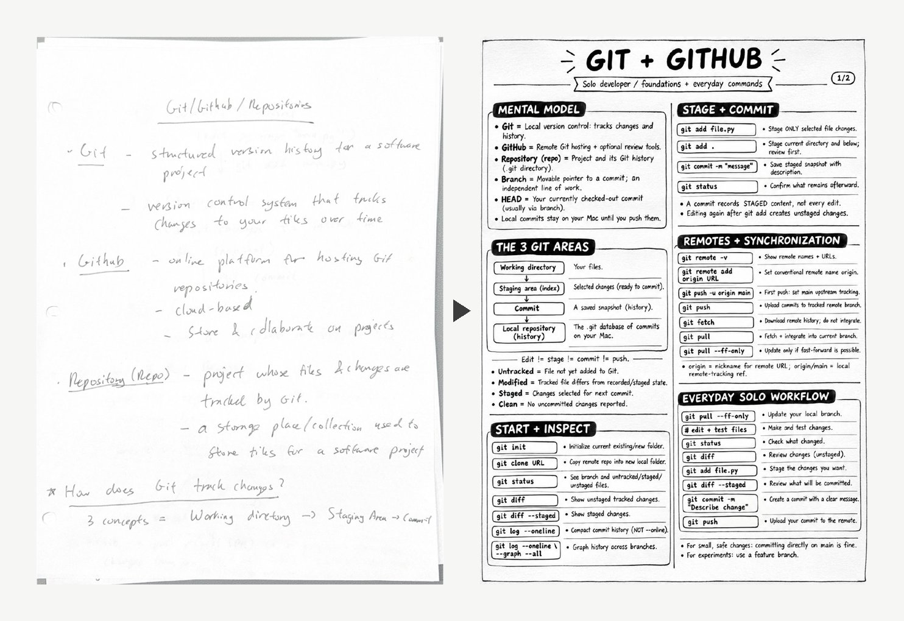
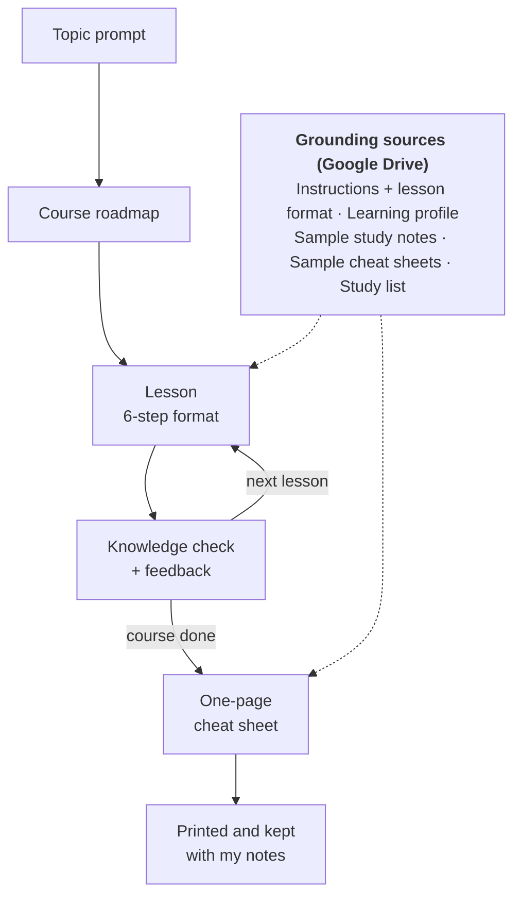
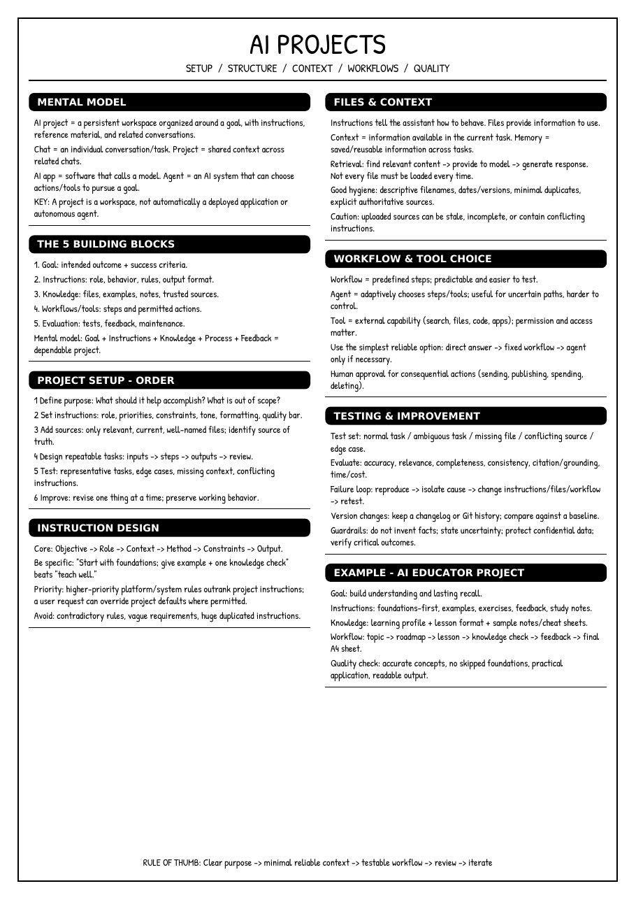

# Personal AI Educator

A personal AI tutor I designed for how I actually learn. I type a topic, it teaches me step by step while I take handwritten notes, and when the course is done it generates a one-page cheat sheet that I print and keep for quick reference.

> **What this repo is:** the design of a configured AI assistant (instructions, lesson format, grounding sources, and lessons learned), not a standalone coded application. It runs as a ChatGPT Project grounded in a Google Drive folder I maintain.

**Status:** In active use since 11/2026 · **Author:** [Kevin Terrier](https://www.linkedin.com/in/kevin-terrier)



<sub>Left: a page of my handwritten notes from the Terminal course. Right: the one-page cheat sheet the educator generated at the end of the course, which I print and keep.</sub>

---

## The problem

I learn best by writing things down during a lesson, then having everything compressed onto one page I can keep and come back to. Generic AI chat is good at answering questions, but it doesn't teach that way. It jumps between levels, skips practice, forgets the format I want, and produces summaries that are either too long to use as a quick reference or too thin to be useful.

I wanted a tutor that would:

- Start from a single word or phrase. Typing "Terminal" should be enough to begin a course.
- Teach in a consistent, structured way, with practice and feedback, not just explanations.
- Adapt to how I learn, using real assessment results as a starting point.
- End with a one-page A4 cheat sheet I can print and keep as a quick reference.

## How it works

| Step | What happens |
|---|---|
| **1. Topic in** | I type a topic, for example "MacBook Basics." No further prompting needed. |
| **2. Roadmap** | The educator proposes a course plan: number of lessons and estimated time. |
| **3. Lessons** | Each lesson follows the same six-step format (below). I take handwritten notes as we go. |
| **4. Knowledge checks** | I answer a question before the answer is revealed; the educator grades my reasoning and corrects gaps. |
| **5. Cheat sheet** | At the end, it compresses the course into one A4 page (front and back at most), designed to be printed. |
| **6. Print and keep** | I print the sheet and keep it with my notes for quick reference. |

### Lesson format

Every lesson uses the same structure, defined in [`instructions/lesson-format.md`](instructions/lesson-format.md):

1. **Foundations:** what is it, and why does it matter?
2. **Conceptual understanding:** how it works, with analogies and visuals.
3. **Practical application:** a relatable, hands-on example.
4. **Knowledge check:** a question I reason through before seeing the answer.
5. **Feedback:** evaluation of my reasoning, misconceptions corrected.
6. **Study notes:** the key points worth keeping for the final cheat sheet.

## Architecture



The Drive folder is organized into three layers so the rules stay stable while the content changes:

1. **Instructions:** how to teach (role, lesson format, output rules).
2. **Reference data:** how I learn (learning profile, study list, sample notes and cheat sheets).
3. **Operational data:** what I'm working on now (course progress and knowledge gaps; template in progress).

More detail in [`design-decisions.md`](design-decisions.md).

## Example outputs



The AI Projects cheat sheet, generated at the end of a course on how to set up AI projects: building blocks, instruction design, files and context, workflows vs. agents, and testing. It even uses this educator as its worked example. See [`examples/`](examples/) for more.

## Repo contents

```
README.md                               ← you are here
instructions/educator-instructions.md   ← the project instructions the educator runs on
instructions/lesson-format.md           ← course roadmap + six-step lesson structure
design-decisions.md                     ← why it's built this way
lessons-learned.md                      ← what worked, what didn't, what changed
examples/                               ← finished cheat sheets and a sample notes page
assets/                                 ← images used in this README
```

**Full version available on request.** My personal learning-assessment results, complete study notes, and working files are kept in a private repository. I'm happy to walk through them in an interview. Reach me on [LinkedIn](https://www.linkedin.com/in/kevin-terrier).

## Tools

**ChatGPT Projects** (instructions, project sources, image and PDF generation) · **Google Drive** (grounding sources, synced to the project) · **Pen and paper** (my notes during lessons, the part I don't automate)

## Related project

[AI Cheat Sheet Generator](https://github.com/kevinterrier43-byte/ai-cheat-sheet-generator) is a coded take on the cheat-sheet step: a Python tool that turns a topic into a printable PDF using structured LLM output and validation.

## What I'd do next

- **Track progress as data.** Save structured outcomes per topic (current lesson, knowledge gaps, next action) instead of relying on chat history, so the educator can resume and review without repeating itself.
- **Spaced review.** Use that tracker to schedule short review sessions on topics I've finished.
- **Make the cheat-sheet layout repeatable.** Generated pages still vary run to run; a fixed template or the coded generator would make them consistent.

---

*Personal document links and learning-assessment results have been removed.*

© 2026 Kevin Terrier. All rights reserved. This repository is shared for portfolio review only; see [LICENSE](LICENSE).
