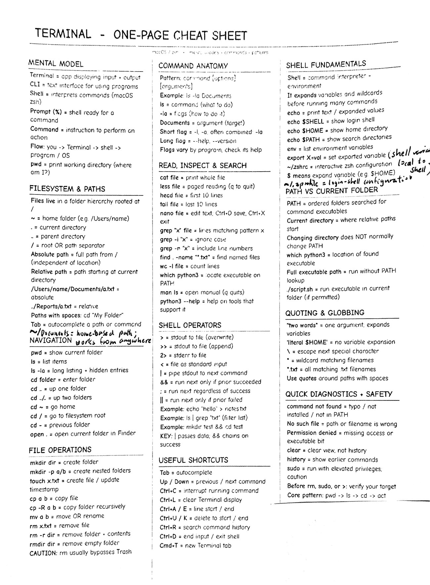
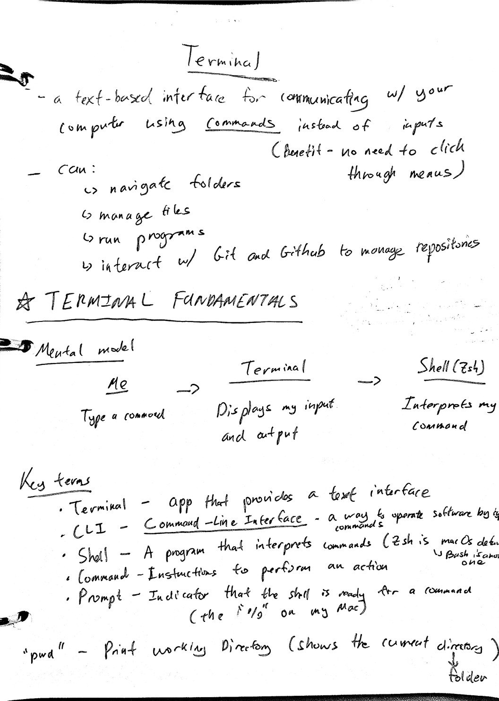

# Example outputs

Cheat sheets the educator generated at the end of a course. I copy each one by hand into my study binder.

## AI Projects (1 page)

## Terminal (1 page)

Printed, with notes I added by hand while studying.

## Input: handwritten study notes

The first page of my notes from the Terminal course.

