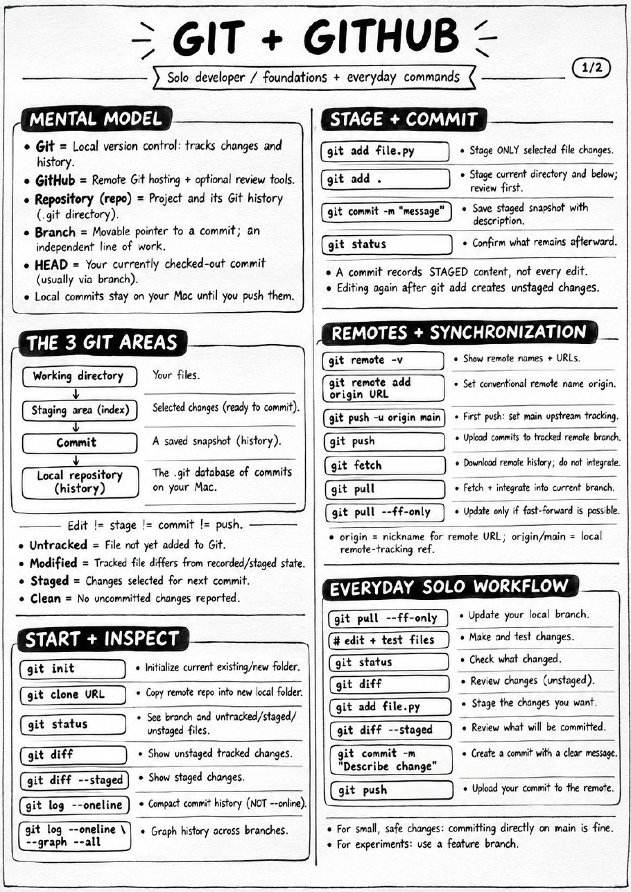
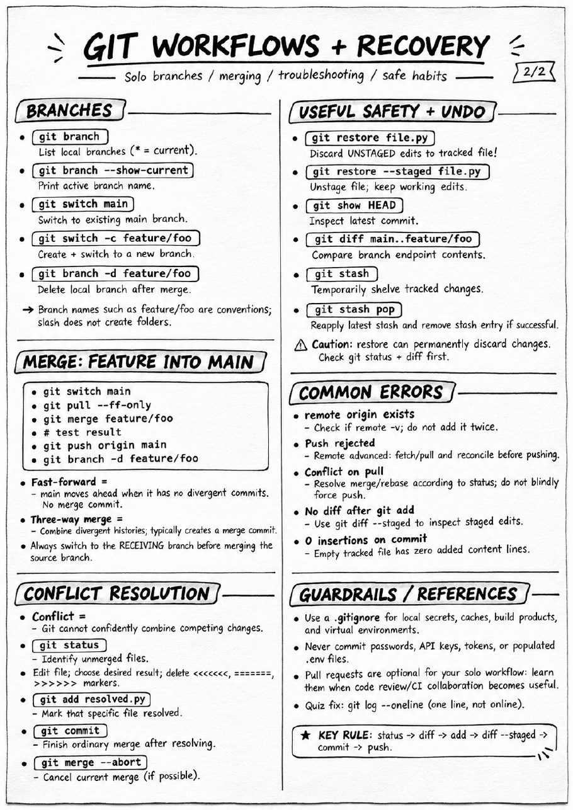
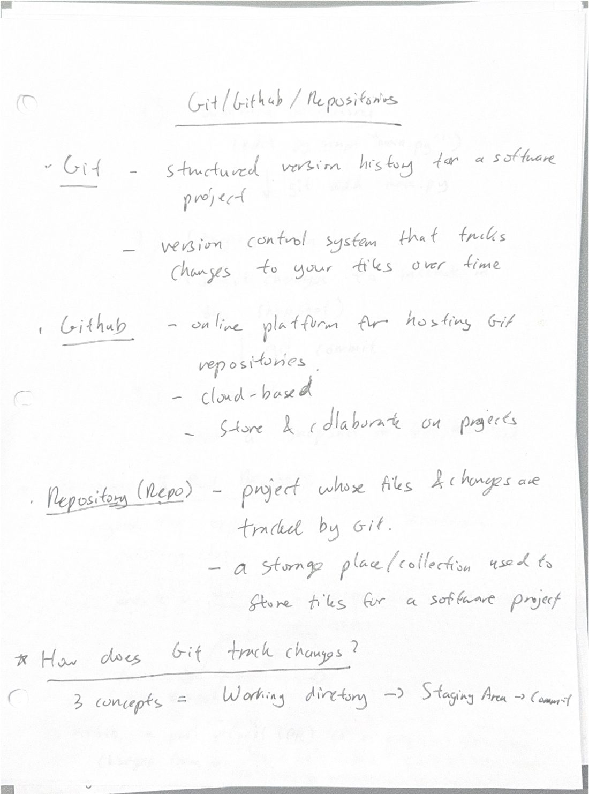

# Example outputs

A cheat sheet generated at the end of a course. I copy each one by hand into my study binder.

## Git & GitHub (2 pages, front and back of one A4 sheet)

## Input: handwritten study notes

A page of my notes from the Git & GitHub course, used as a sample of how I take notes.

